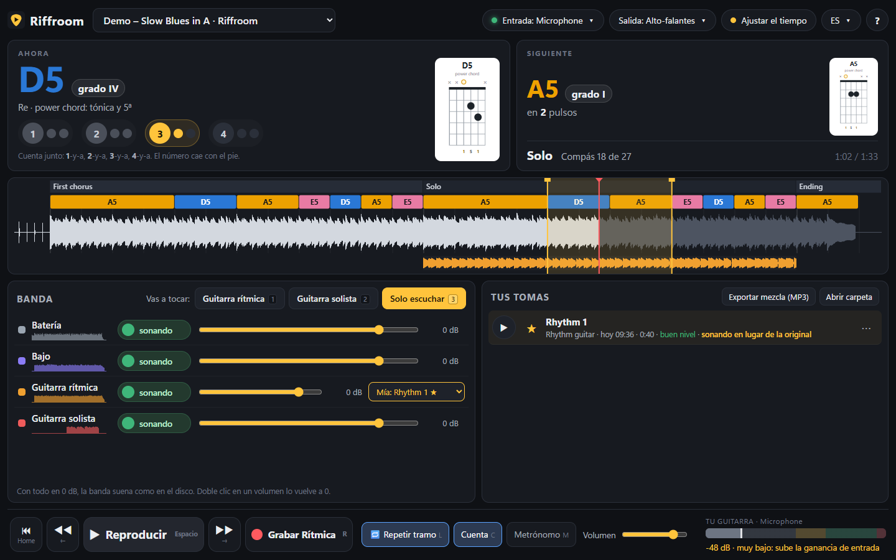

# Riffroom

Toca y graba junto con la banda separada: el acorde y el pulso en pantalla, y tus tomas alineadas con la música y analizadas compás a compás. También funciona con un asistente de IA.

[English](README.md) · [Português](README.pt-BR.md) · **Español**



Hecho para practicar guitarra en casa, con la pedalera conectada a la computadora por USB (probado con la BOSS GT-100). Funciona con cualquier interfaz de audio y cualquier instrumento. Es gratis y de código abierto (GPL-3.0). Todo corre en tu computadora: las canciones y las grabaciones no van a la nube.

## Qué hace

- **Banda separada**: enciende, apaga y cambia el volumen de cada parte (batería, bajo, guitarras, voz…). Con todo en 0 dB, la banda suena como en el disco.
- **"Vas a tocar"**: un clic apaga la parte que vas a tocar y define dónde va la grabación.
- **Panel AHORA**:
  - el acorde que suena, el grado (I, IV, V…) y la forma en el mástil;
  - el próximo acorde;
  - los pulsos del compás encendiéndose a tiempo (12/8 o 4/4).
- **Línea de tiempo**: muestra las partes de la canción, los acordes y la onda.
  - Un clic lleva al compás.
  - Arrastrar marca un tramo para repetir.
  - Doble clic en una parte de la canción la repite entera.
- **Cuenta y metrónomo**: 4 pulsos antes de tocar o grabar, desde cualquier punto.
- **Tomas**:
  - un botón graba, y cada grabación es una toma ya alineada con la banda (FLAC de 24 bits);
  - la app mide una vez el retraso de la computadora ("Ajustar el tiempo") y corrige la deriva de reloj entre la interfaz y la placa de sonido.
- **Análisis del tiempo** de cada toma, respecto a la parte original o al pulso:
  - adelantado o atrasado, y la constancia;
  - los compases para practicar y dónde te apuraste o te arrastraste.
- **Comparar**:
  - cada parte toca la original o una toma tuya;
  - favoritas, cambiar nombre, borrar (con deshacer), exportar MP3.
- **Letra**, opcional: la línea que se canta se ilumina y la letra avanza sola, o queda solo el texto, para leer.
  - Pégala o deja un archivo `.lrc` (letra con el tiempo de cada línea) en la carpeta de la canción: Riffroom lo alinea con la voz separada.
  - Sin tiempos, márcalos mientras suena, pulsando Enter al empezar cada línea.
- **Importar una canción con IA**: convierte un MP3 en una canción para ensayar, en tu computadora.
  1. [Demucs](https://github.com/adefossez/demucs) separa los instrumentos.
  2. [beat-this](https://github.com/CPJKU/beat_this) encuentra los pulsos y los compases.
  3. La app sugiere los acordes.
- **Hecho para asistentes de IA**: un servidor [MCP](https://modelcontextprotocol.io) permite que Claude (Desktop o Code), o cualquier cliente MCP, maneje Riffroom y sea tu profesor (ver [Con un asistente de IA](#con-un-asistente-de-ia)).
- **Tres idiomas**: inglés, portugués y español.

## Qué necesitas

- Windows 10 u 11. La ventana de la app es Edge, que ya viene con Windows.
- Python 3.10 o más nuevo (probado con 3.13), gratis en [python.org](https://www.python.org/downloads/).
- Una interfaz de audio para el instrumento: una pedalera con USB (como la BOSS GT-100), una placa de sonido o la entrada de la propia computadora.
- Para la IA local (opcional): unos 1,5 GB de disco.

## Instalar

1. Descarga el ZIP de la [última versión](https://github.com/luanmadson/riffroom/releases/latest) y descomprímelo, o ejecuta:
   ```
   git clone https://github.com/luanmadson/riffroom
   ```
2. Haz doble clic en **`install.bat`**. Este:
   - crea el entorno Python de la app en `%LOCALAPPDATA%\Riffroom\venv`;
   - instala las bibliotecas;
   - crea la **canción de demostración** (un blues lento en La, sintetizado por la propia app);
   - crea el acceso directo **Riffroom** en el Escritorio y en el menú Inicio;
   - registra Riffroom en Claude Code y Claude Desktop, cuando están instalados;
   - abre la app.

Opciones (valen también con `install.bat`):

| Opción | Qué hace |
|---|---|
| `-AI` | Instala la IA local: PyTorch para CPU, Demucs, beat-this y librosa (~1,5 GB). |
| `-AI -GPU` | Lo mismo, con PyTorch para placas NVIDIA (CUDA, ~3 GB). La separación tarda segundos en lugar de minutos. |
| `-Language es` | Abre en español (`pt` para portugués). También se puede cambiar después, en la app. |
| `-Library CARPETA` | Agrega una carpeta de canciones. |
| `-NoClaude` | No registra Riffroom en los asistentes de IA. |
| `-Uninstall` | Quita los accesos directos, el registro y el entorno. Las canciones y las tomas se quedan. |

Si Windows avisa que el archivo vino de internet, haz clic en "Más información" y después en "Ejecutar de todas formas".

## Primeros pasos

1. Abre Riffroom desde el acceso directo. La primera vez, un paso a paso muestra cada área.
2. Arriba, revisa:
   - la **Entrada**, de dónde viene tu guitarra (la GT-100 se elige sola);
   - la **Salida**, dónde suena la banda: en los parlantes de la computadora o en la propia interfaz.
3. Haz una vez **Ajustar el tiempo**: apaga las cuerdas y rasguea junto con 8 clics. Lleva unos 10 segundos.
4. En **Vas a tocar**, elige la parte y pulsa **Grabar** (R).
5. El ▶ de la toma la toca en lugar de la original. **⋯ > Analizar el tiempo** muestra dónde te apuraste o te arrastraste.

## Tus canciones

### Importar con IA

En el menú de canciones, elige **＋ Importar canción (MP3, WAV, FLAC)… con IA**. Necesita `install.bat -AI`. La app entonces:
1. separa los instrumentos (Demucs `htdemucs_6s`: batería, bajo, guitarra, piano, voz, otros);
2. encuentra los pulsos y los compases;
3. agrega 4 pulsos de silencio antes del compás 1, para la cuenta;
4. sugiere los acordes;
5. guarda todo en `<carpeta de canciones>\<Artista>\<Título>\`.

En una CPU común, una canción de 6 minutos tarda unos 2 minutos. Los acordes quedan en `chords.txt` como **sugerencia**: escúchalos y corrígelos (el formato está abajo) y abre la canción de nuevo.

**¿Qué tan buena es?** Comparamos la IA con el mapa revisado a mano de un rock real en 12/8.
- **Tempo:** dentro de 1 pulso por minuto.
- **Compases:** el 91% empieza a menos de 60 ms de los revisados.
- **Acordes:** la tónica acierta alrededor del 60% del tiempo. Los acordes sus salen como power chord o mayor.

### Carpetas con las pistas separadas

La app también encuentra canciones que separaste tú. Agrega la carpeta desde el menú de canciones (**＋ Agregar carpeta de canciones…**). Cada canción va en su propia carpeta, con las pistas:

```
Riffroom\
└── Mi banda\
    └── Mi canción\
        ├── drums.wav      (bass.wav, guitar.wav, vocals.wav, other.wav, piano.wav: los nombres de Demucs)
        ├── mixture.wav    (opcional: la canción entera, para ajustar el volumen de cada parte)
        └── chords.txt     (opcional: el cifrado)
```

También valen los nombres en español y portugués (bateria, bajo, guitarra, voz…), y `rhythm_guitar` y `lead_guitar`. La primera vez que abres la canción, la app la prepara sola.

Para ver el pulso, el acorde y la cuenta, indica el tempo. Ejecútalo con el Python de la app:

```
%LOCALAPPDATA%\Riffroom\venv\Scripts\python.exe app\prepare.py "<carpeta de la canción>" --bpm 92 --time-signature 4/4 --first-bar 1.25
```

| Opción | Qué significa |
|---|---|
| `--bpm` | Pulsos por minuto, el pulso en que marcas con el pie. En 12/8 es la negra con puntillo. |
| `--first-bar` | El segundo en que empieza el compás 1. |
| `--tuning -1` | Para una guitarra afinada medio tono abajo: los acordes se nombran por la forma que tocas. |
| `--targets guitar,vocals` | Las partes que aparecen en "Vas a tocar". |

### Cifrado (`chords.txt`)

Un compás por palabra:

```
[Intro]
A5 % D5 A5
[Verso]
A5 % % %
D5 % A5 %
E5 D5,C5 A5 -
```

| Signo | Qué significa |
|---|---|
| `%` | repite el compás anterior |
| `D5,C5` | divide el compás entre los dos acordes |
| `-` | compás sin acorde |
| `[Nombre]` | empieza una parte de la canción |
| `#` al inicio de la línea | comentario |

La app calcula el grado de cada acorde y dibuja la forma. La canción de demostración trae un ejemplo completo.

### Letra (`lyrics.lrc`)

Riffroom no busca letras: las pones tú. El botón **Letra** (tecla K) la muestra junto a la banda.

- **Pegar**: ⋯ > Editar o pegar la letra. Texto simple (una línea por cada línea cantada, una línea en blanco entre estrofas) o LRC, con el tiempo de cada línea: `[01:04.17]Primera línea`.
- **Desde un archivo**: un `.lrc` en la carpeta de la canción (o junto a su `riffroom.json`) se lee la primera vez que se abre la canción. Esos archivos suelen tener los tiempos de la grabación original, que empieza en otro punto que las pistas separadas. Riffroom desplaza los tiempos para alinearlos con la voz separada, cuando la canción la tiene, y guarda su copia como `lyrics.lrc`, junto al `riffroom.json`. El archivo original no cambia.
- **Ajuste fino**: los botones −0,1 s y +0,1 s mueven todas las líneas; ⋯ > Alinear con la voz de la canción lo intenta de nuevo.
- **Sin tiempos**: ⋯ > Marcar los tiempos mientras suena. Pulsa Enter (o **Ahora**) cuando empiece cada línea; Retroceso vuelve una línea; Esc termina y guarda.
- **Seguir** activado: la línea que se canta se ilumina un poco antes y la lista avanza sola. Desactivado: solo el texto, para leer. Haz clic en una línea para tocar desde ahí.

## Con un asistente de IA

Riffroom trae un servidor MCP ([app/mcp_server.py](app/mcp_server.py)). Con él, un asistente de IA conduce tu práctica. Por ejemplo:

- "Abre la canción de demostración, repite el solo y graba tres tomas de la guitarra rítmica."
- "¿Dónde me apuré? ¿Qué debo practicar?"
- "Compara mis últimas tomas."
- "Importa C:\Música\cancion.mp3; la guitarra está medio tono abajo."
- "Los acordes del verso son A5 D5 A5 E5. Escribe el cifrado."

El asistente ve solo lo que devuelven las herramientas: la estructura de la canción, el estado de la app y los análisis de tiempo, nunca tu audio. Las herramientas están en el [README en inglés](README.md#with-an-ai-assistant).

El `install.bat` hace el registro solo. Para hacerlo a mano:

```
claude mcp add riffroom --scope user -- "%LOCALAPPDATA%\Riffroom\venv\Scripts\python.exe" -I -X utf8 "<carpeta>\app\mcp_server.py"
```

Si Riffroom está cerrado cuando el asistente lo necesita, el servidor lo abre.

## Teclas

| Tecla | Qué hace |
|---|---|
| Espacio | reproducir y pausar (y detener la grabación) |
| R | grabar y detener |
| Inicio | volver al inicio (o al inicio del tramo) |
| ← → | compás anterior y siguiente |
| L | repetir el tramo, activar y desactivar |
| C | cuenta, activar y desactivar |
| M | metrónomo, activar y desactivar |
| K | letra, mostrar y ocultar |
| 1 2 3… | vas a tocar: los botones del panel Banda, en orden |
| ? | ayuda |

## Dónde quedan los archivos

| Qué | Dónde |
|---|---|
| Tomas | `Grabaciones\Tomas\`, dentro de la carpeta de la canción: FLAC y una ficha `.json`. En inglés, `Takes\`; en portugués, `Gravações\Tentativas\`. Vale la carpeta que ya exista. |
| Tomas borradas | `Grabaciones\Tomas\Papelera\` |
| MP3 exportados | `Grabaciones\Exportados\` |
| Letra | `lyrics.lrc`, junto al `riffroom.json` de la canción |
| Configuración y registro | `%LOCALAPPDATA%\Riffroom\` (carpetas de canciones, idioma, entrada, ajuste del tiempo, mezcla de cada canción) |

## Pruebas

```
%LOCALAPPDATA%\Riffroom\venv\Scripts\python.exe -X utf8 tests\run_tests.py
```

Las pruebas no necesitan ningún dispositivo de audio. Las de IA corren cuando la IA local está instalada.

## Licencia

[GPL-3.0-or-later](LICENSE). La versión 1.0.0, publicada como "Sala de Ensaio", salió con licencia MIT.
