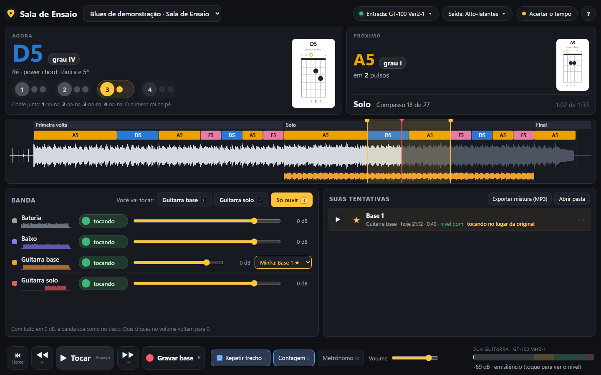

# Sala de Ensaio

Toque e grave junto com a banda separada: cada instrumento numa faixa, o acorde e o pulso na tela, e as suas gravações já alinhadas com a música.



Feito para estudar guitarra em casa, com a pedaleira ligada no computador pela USB (testado com a BOSS GT-100), no lugar de um editor de áudio genérico. Funciona com qualquer interface de áudio. É grátis e não usa a nuvem: as músicas e as gravações ficam no seu computador.

## O que ele faz

- **Banda separada**: liga, desliga e muda o volume de cada parte (bateria, baixo, guitarras, voz…). Com tudo em 0 dB, a banda soa como no disco.
- **"Você vai tocar"**: um clique desliga a parte que você vai tocar e define em que parte a gravação entra.
- **Painel AGORA**: o acorde que está soando, o grau (I, IV, V…), o desenho no braço e o próximo acorde, com os pulsos do compasso acendendo no tempo (12/8 ou 4/4).
- **Linha do tempo**: mostra as partes da música, os acordes e a onda. Um clique leva ao compasso, arrastar marca um trecho para repetir e dois cliques repetem uma parte inteira.
- **Contagem** de 4 pulsos antes de tocar ou gravar, de qualquer ponto, e **metrônomo**.
- **Tentativas**:
  - um botão grava, e cada gravação vira uma tentativa já alinhada com a banda (FLAC de 24 bits);
  - o app mede uma vez o atraso do computador ("Acertar o tempo") e corrige a diferença de relógio entre a interface e a placa de som.
- **Comparar**:
  - cada parte toca a original ou uma tentativa sua;
  - dá para marcar favoritas, renomear e apagar (com desfazer).
- **MP3** da tentativa ou da mistura, para ouvir no celular.
- **Medidor** do nível da guitarra, com a dica do que ajustar.

## Do que precisa

- Windows 10 ou 11. A janela do app é a do Edge, que já vem no Windows.
- Python 3.10 ou mais novo (testado no 3.13), grátis em [python.org](https://www.python.org/downloads/).
- Uma interface de áudio para a guitarra: pedaleira com USB (como a BOSS GT-100), placa de som externa ou a entrada do próprio computador.
- As músicas em faixas separadas (veja [Suas músicas](#suas-músicas)).

## Instalar

1. Baixe o projeto. Pode ser o ZIP da [última versão](https://github.com/luanmadson/sala-de-ensaio/releases/latest), que você extrai, ou:
   ```
   git clone https://github.com/luanmadson/sala-de-ensaio
   ```
2. Dê dois cliques em **`instalar.bat`**. Ele:
   - cria o ambiente Python do app em `%LOCALAPPDATA%\SalaDeEnsaio\venv`, fora das pastas sincronizadas;
   - instala as bibliotecas: numpy, scipy, soundfile, sounddevice e lameenc;
   - gera a **música de demonstração**, um blues em Lá sintetizado pelo próprio app;
   - cria o atalho **Sala de Ensaio** na Área de Trabalho e no menu Iniciar, e abre o app.

Se o Windows avisar que o arquivo veio da internet, clique em "Mais informações" e depois em "Executar assim mesmo".

Para remover, rode `instalar.bat -Desinstalar`. As músicas e as gravações ficam onde estão.

## Primeiros passos

1. Abra o app pelo atalho. Na primeira vez, um passo a passo mostra cada área da tela.
2. No topo, confira:
   - a **Entrada**, de onde vem a guitarra (a GT-100 é escolhida sozinha);
   - a **Saída**, onde a banda toca: na caixa do computador ou na própria interface.
3. Faça uma vez o **Acertar o tempo**: abafe as cordas e palhete junto com 8 cliques. Leva uns 10 segundos.
4. Em **Você vai tocar**, escolha a parte e aperte **Gravar** (tecla R). Depois, o ▶ da tentativa toca a sua gravação no lugar da original.

## Suas músicas

O app procura as músicas na pasta `Músicas\Sala de Ensaio` do Windows. Para juntar outras pastas, use **＋ Adicionar pasta de músicas…** no menu das músicas.

Cada música fica numa pasta própria, com as faixas separadas:

```
Sala de Ensaio\
└── Minha banda\
    └── Minha música\
        ├── drums.wav      (ou bateria.wav)
        ├── bass.wav       (ou baixo.wav)
        ├── guitar.wav     (ou guitarra.wav, guitarra_base.wav, guitarra_solo.wav)
        ├── vocals.wav     (ou voz.wav)
        ├── other.wav      (ou outros.wav)
        ├── mixture.wav    (opcional: a música inteira, para acertar o volume de cada parte)
        └── acordes.txt    (opcional: a cifra, veja abaixo)
```

Na primeira vez que você abre a música, o app a prepara sozinho e grava um `ensaio.json` na pasta. As faixas podem ser WAV, FLAC, MP3 ou OGG, todas com a mesma taxa de amostragem.

### Separar os instrumentos com o Demucs

O [Demucs](https://github.com/adefossez/demucs) separa uma música em faixas com IA, no seu computador, sem mandar nada para a internet. Ele instala o PyTorch (alguns GB), então o melhor é instalá-lo num ambiente Python próprio:

```
pip install demucs
demucs -n htdemucs_6s "minha música.mp3"
```

As faixas saem em `separated\htdemucs_6s\minha música\`: drums, bass, guitar, piano, vocals e other. Copie essa pasta para dentro da sua pasta de músicas.

### Compassos, acordes e partes da música (opcional)

Para ver o pulso, o acorde e a contagem, informe o andamento e escreva a cifra. Rode com o Python do app:

```
%LOCALAPPDATA%\SalaDeEnsaio\venv\Scripts\python.exe app\preparar_musica.py "<pasta da música>" --bpm 92 --compasso 4/4 --inicio 1.25
```

- `--bpm`: pulsos por minuto, o pulso em que você bate o pé. Num 12/8, é a semínima pontuada.
- `--compasso`: 4/4 (o padrão), 3/4, 6/8, 12/8…
- `--inicio`: o segundo em que começa o compasso 1.
- `--titulo`, `--artista`: como aparece no menu das músicas.
- `--alvos guitarra,voz`: as partes que aparecem em "Você vai tocar".

A cifra fica em `acordes.txt`, na pasta da música, com um compasso por palavra:

```
[Intro]
A5 % D5 A5
[Verso]
A5 % % %
D5 % A5 %
E5 D5,C5 A5 -
```

| Sinal | O que quer dizer |
|---|---|
| `%` | repete o compasso anterior |
| `D5,C5` | divide o compasso entre os dois acordes |
| `-` | compasso sem acorde |
| `[Nome]` | começa uma parte da música |
| `#` no início da linha | comentário |

O app calcula o grau de cada acorde e desenha a digitação. A música de demonstração traz um exemplo completo.

## Teclas

| Tecla | O que faz |
|---|---|
| Espaço | tocar e pausar (e parar a gravação) |
| R | gravar e parar |
| Home | voltar ao começo (ou ao começo do trecho) |
| ← → | compasso anterior e próximo |
| L | repetir o trecho, liga e desliga |
| C | contagem, liga e desliga |
| M | metrônomo, liga e desliga |
| 1 2 3… | você vai tocar: os botões do painel Banda, na ordem |
| ? | ajuda |

## Onde ficam os arquivos

| O quê | Onde |
|---|---|
| Tentativas | `Gravações\Tentativas\`, dentro da pasta da música (FLAC e uma ficha `.json`) |
| Tentativas apagadas | `Gravações\Tentativas\Lixeira\` |
| MP3 exportados | `Gravações\Exportados\` |
| Configuração e registro | `%LOCALAPPDATA%\SalaDeEnsaio\` (pastas de músicas, entrada e ajuste do tempo) |

## Como funciona

- **`app/sala_de_ensaio.py`**:
  - um servidor local, só em 127.0.0.1, feito com a biblioteca padrão do Python;
  - a janela é a do Edge em modo app;
  - a tela fala com o servidor por JSON e recebe os eventos por SSE.
- **`app/motor.py`**: o áudio, com o [sounddevice](https://python-sounddevice.readthedocs.io) (PortAudio, WASAPI):
  - mistura as partes, o trecho, a contagem e o metrônomo, sem estalos;
  - grava a entrada e guarda a hora de cada bloco.
- **Alinhamento**:
  1. O PortAudio informa a hora em que cada bloco sai na caixa e a hora em que cada bloco entra.
  2. Com isso, a primeira amostra gravada fica ligada à posição da música que estava soando naquele instante.
  3. Uma reta pelas horas mede a diferença entre o relógio da interface e o da placa de som. Se a diferença passar de 1,5 ms na gravação, a tentativa é reamostrada.
  4. O "Acertar o tempo" mede o atraso que sobra, o do caminho da guitarra, com cliques e palhetadas abafadas.
- **`app/tentativas.py`**: alinha, guarda, organiza e exporta (o MP3 é feito com o [lameenc](https://github.com/chrisstaite/lameenc)).
- **`app/preparar_musica.py`**:
  - reconhece as faixas;
  - acerta o volume de cada parte por mínimos quadrados contra a música inteira;
  - monta os compassos, os acordes e as partes da música.
- **`app/web/`**: a tela, em HTML, CSS e JavaScript puros, sem bibliotecas de fora.
- **`demo/gerar_demo.py`**: sintetiza a música de demonstração (bateria, baixo e guitarras por Karplus-Strong e síntese aditiva).

## Testes

```
%LOCALAPPDATA%\SalaDeEnsaio\venv\Scripts\python.exe -X utf8 testes\testes.py
```

Os testes não precisam de aparelho de som.

## Licença

[MIT](LICENSE). As bibliotecas usadas têm as próprias licenças:
- numpy, scipy e soundfile: BSD;
- sounddevice: MIT;
- lameenc: LGPL.

---

### In English

Sala de Ensaio ("rehearsal room") is a Windows app to play and record along with a song split into stems (drums, bass, guitars, vocals…). The interface is in Portuguese.

- It shows the current chord with its scale degree and fingering, a beat counter (12/8 or 4/4) and a timeline with sections and loops.
- It records takes that are aligned with the band automatically: the clock drift between the audio interface and the sound card is measured and corrected.
- To install, run `instalar.bat` (it needs Python 3.10 or newer).
- Stems from Demucs (`drums.wav`, `bass.wav`, `vocals.wav`…) are recognized automatically.
- MIT license.
