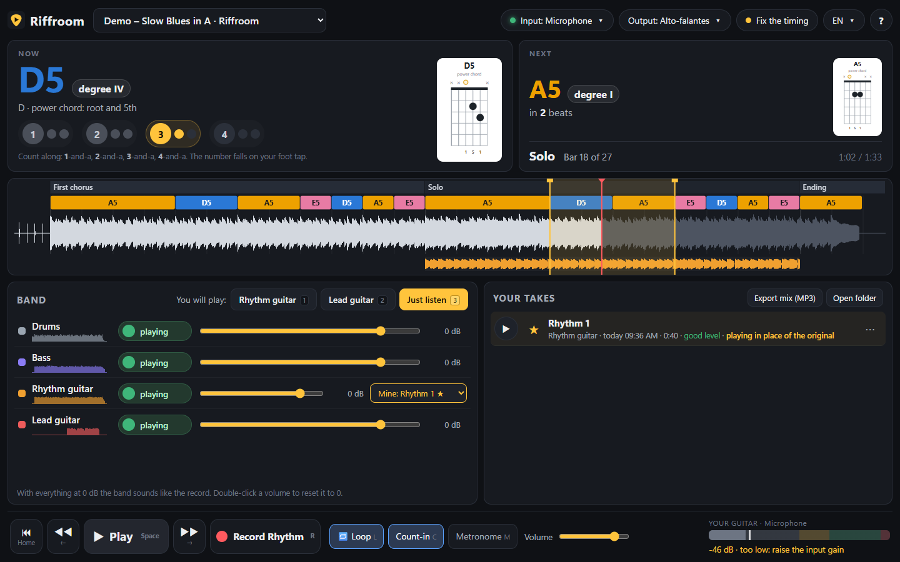

# Riffroom

Play and record along with the separated band: the chord and the beat on screen, and your takes aligned with the music and analyzed bar by bar. It works with an AI assistant too.

**English** · [Português](README.pt-BR.md) · [Español](README.es.md)



Riffroom was made for practicing guitar at home with a multi-effects pedal connected by USB (tested with a BOSS GT-100), but it works with any audio interface and any instrument. It is free and open source (GPL-3.0). Everything runs on your computer: your songs and recordings never go to the cloud.

## What it does

- **The band, separated**: turn each part (drums, bass, guitars, vocals…) on and off and set its volume. With everything at 0 dB, the band sounds like the record.
- **"You will play"**: one click mutes the part you are going to play and sets where the recording goes.
- **NOW panel**:
  - the chord that is sounding, its degree (I, IV, V…) and its shape on the neck;
  - the next chord;
  - the beats of the bar lighting up in time (12/8 or 4/4).
- **Timeline**: shows the sections, the chords and the waveform.
  - A click goes to that bar.
  - Dragging marks a part to loop.
  - Double-clicking a section loops that whole section.
- **Count-in and metronome**: 4 beats before playing or recording, from any point.
- **Takes**:
  - one button records, and each take comes out already aligned with the band (24-bit FLAC);
  - Riffroom measures the delay of your computer once ("Fix the timing") and corrects the clock drift between the interface and the sound card.
- **Timing analysis** of each take, against the original part or the beat:
  - early or late, and how consistent you are;
  - which bars to practice, and where you rushed or dragged.
- **Compare**:
  - each part plays the original or one of your takes;
  - mark favorites, rename, delete (with undo), export MP3;
  - delete many at once: tick the boxes (Shift+click ticks a range, "All but ★" keeps the favorites);
  - filter the list by part (All, Rhythm, Bass…), with how many takes each one has.
- **Lyrics**, optional: the line being sung lights up and the lyrics scroll by themselves, or just the text, to read.
  - Paste them, or leave an `.lrc` file (lyrics with the time of each line) in the song folder: Riffroom lines it up with the separated voice.
  - Without times, mark them while the song plays, pressing Enter at the start of each line.
- **Import a song with AI**: turn an MP3 into a practice song, on your computer.
  1. [Demucs](https://github.com/adefossez/demucs) separates the instruments.
  2. [beat-this](https://github.com/CPJKU/beat_this) finds the beats and the bars.
  3. Riffroom suggests the chords.
- **Made for AI assistants**: an [MCP](https://modelcontextprotocol.io) server lets Claude (Desktop or Code), or any MCP client, drive Riffroom and coach you (see [With an AI assistant](#with-an-ai-assistant)).
- **Three languages**: English, Portuguese and Spanish.

## Requirements

- Windows 10 or 11. The app window is Microsoft Edge, which comes with Windows.
- Python 3.10 or newer (tested with 3.13), free at [python.org](https://www.python.org/downloads/).
- An audio interface for your instrument: a pedal with USB (like the BOSS GT-100), a sound card, or the computer's own input.
- For the local AI (optional): about 1.5 GB of disk.

## Install

1. Download the [latest release](https://github.com/luanmadson/riffroom/releases/latest) ZIP and extract it, or run:
   ```
   git clone https://github.com/luanmadson/riffroom
   ```
2. Double-click **`install.bat`**. It:
   - creates the app's Python environment in `%LOCALAPPDATA%\Riffroom\venv`;
   - installs the libraries;
   - makes the **demo song** (a slow blues in A, synthesized by Riffroom itself);
   - creates the **Riffroom** shortcut on the Desktop and in the Start menu;
   - registers Riffroom for Claude Code and Claude Desktop, when they are installed;
   - opens the app.

Options (also work with `install.bat`):

| Option | What it does |
|---|---|
| `-AI` | Installs the local AI: PyTorch for CPU, Demucs, beat-this and librosa (~1.5 GB). |
| `-AI -GPU` | The same, with PyTorch for NVIDIA cards (CUDA, ~3 GB). Separating takes seconds instead of minutes. |
| `-Language pt` | Starts in Portuguese (`es` for Spanish). You can also change it later in the app. |
| `-Library FOLDER` | Adds a folder of songs. |
| `-NoClaude` | Does not register Riffroom with AI assistants. |
| `-Uninstall` | Removes the shortcuts, the registration and the environment. Your songs and takes stay. |

If Windows warns that the file came from the internet, click "More info", then "Run anyway".

## First steps

1. Open Riffroom from the shortcut. The first time, a short tour shows each area.
2. At the top, check:
   - the **Input**, where your guitar comes from (the GT-100 is picked automatically);
   - the **Output**, where the band plays: the computer speakers, or the interface itself.
3. Do **Fix the timing** once: mute the strings and strum together with 8 clicks. It takes about 10 seconds.
4. In **You will play**, choose your part and press **Record** (R).
5. Press ▶ on the take to hear it in place of the original. The take's **⋯ > Analyze the timing** shows where you rushed or dragged.

## Your songs

### Import with AI

In the songs menu, choose **＋ Import a song (MP3, WAV, FLAC)… with AI**. It needs `install.bat -AI`. Riffroom then:
1. separates the instruments (Demucs `htdemucs_6s`: drums, bass, guitar, piano, vocals, other);
2. finds the beats and the bars;
3. adds 4 beats of silence before bar 1 for the count-in;
4. suggests the chords;
5. writes everything to `<music folder>\<Artist>\<Title>\`.

On a typical CPU, a 6-minute song takes about 2 minutes. The chords are written to `chords.txt` as a **suggestion**: listen and correct them (see the format below), then open the song again.

**How good is it?** We compared the AI with a hand-checked map of a real 12/8 rock song.
- **Tempo:** within 1 beat per minute.
- **Bars:** 91% start within 60 ms of the checked ones.
- **Chords:** the root note is right about 60% of the time. Sus chords are named as power chords or major.

### Folders with separated tracks

Riffroom also finds songs that you separated yourself. Add the folder from the songs menu (**＋ Add a music folder…**). Each song needs its own folder with the tracks:

```
Riffroom\
└── My band\
    └── My song\
        ├── drums.wav      (bass.wav, guitar.wav, vocals.wav, other.wav, piano.wav — the Demucs names)
        ├── mixture.wav    (optional: the whole song, to set the volume of each part)
        └── chords.txt     (optional: the chord chart)
```

Names in Portuguese and Spanish work too (bateria, baixo, guitarra, voz…), as do `rhythm_guitar` and `lead_guitar`. The first time you open the song, Riffroom prepares it by itself.

To see the beat, the chords and the count-in, give the tempo. Run it with the app's Python:

```
%LOCALAPPDATA%\Riffroom\venv\Scripts\python.exe app\prepare.py "<song folder>" --bpm 92 --time-signature 4/4 --first-bar 1.25
```

| Option | Meaning |
|---|---|
| `--bpm` | Beats per minute, the beat you tap your foot to. In 12/8 it is the dotted quarter note. |
| `--first-bar` | The second where bar 1 starts. |
| `--tuning -1` | For a guitar tuned a half step down: the chords are named by the shape you play. |
| `--targets guitar,vocals` | The parts shown in "You will play". |

### Chord chart (`chords.txt`)

One bar per word:

```
[Intro]
A5 % D5 A5
[Verse]
A5 % % %
D5 % A5 %
E5 D5,C5 A5 -
```

| Sign | Meaning |
|---|---|
| `%` | repeats the previous bar |
| `D5,C5` | splits the bar between the two chords |
| `-` | a bar with no chord |
| `[Name]` | starts a section of the song |
| `#` at the start of a line | a comment |

Riffroom works out the degree of each chord and draws the shape. The demo song has a complete example.

### Lyrics (`lyrics.lrc`)

Riffroom does not fetch lyrics: they come from you. The **Lyrics** button (key K) shows them next to the band.

- **Paste them**: ⋯ > Edit or paste the lyrics. Plain text (a line for each sung line, a blank line between verses) or LRC, with the time of each line: `[01:04.17]First line`.
- **From a file**: an `.lrc` in the song folder (or next to its `riffroom.json`) is read the first time the song opens. These files are usually timed to the original record, which starts at a different point than the separated tracks. Riffroom shifts the times to line them up with the separated voice, when the song has one, and keeps its copy as `lyrics.lrc`, next to `riffroom.json`. The original file is not changed.
- **Fine-tuning**: the −0.1 s and +0.1 s buttons move every line; ⋯ > Line up with the voice tries again.
- **Without times**: ⋯ > Mark the times while it plays. Press Enter (or **Now**) when each line starts; Backspace goes back a line; Esc finishes and saves.
- **Follow** on: the line being sung lights up a moment early and the list scrolls by itself. Off: just the text, to read. Click a line to play from it.

## With an AI assistant

Riffroom comes with an MCP server ([app/mcp_server.py](app/mcp_server.py)). With it, an AI assistant can run a practice session for you. For example:

- "Open the demo song, loop the solo and record three takes of the rhythm guitar."
- "Where did I rush? What should I practice?"
- "Compare my last takes."
- "Import C:\Music\song.mp3; the guitar is tuned a half step down."
- "These are the chords of the verse: A5 D5 A5 E5. Write the chart."

The assistant sees only what the tools return: the structure of the song, the state of the app and the timing analyses, never your audio. The tools are:
- songs: `list_songs`, `open_song`, `get_song_map`;
- playback: `play`, `pause`, `set_loop`, `clear_loop`;
- the band: `set_part`, `set_target`, `set_options`;
- recording and takes: `record_take`, `stop_recording`, `list_takes`, `play_take`, `update_take`, `delete_take` (one or several), `analyze_take`, `compare_takes`, `export_mp3`;
- preparing songs: `set_chords`, `prepare_song`, `import_song`, `get_job`;
- lyrics: `get_lyrics` (each line with its second, bar and section), `set_lyrics`, `shift_lyrics`;
- `calibrate_latency` and `get_status`.

There is also a `coach_session` prompt.

`install.bat` registers the server automatically. To do it by hand:

```
claude mcp add riffroom --scope user -- "%LOCALAPPDATA%\Riffroom\venv\Scripts\python.exe" -I -X utf8 "<folder>\app\mcp_server.py"
```

For Claude Desktop, add this to `%APPDATA%\Claude\claude_desktop_config.json`, then restart Claude Desktop:

```json
{ "mcpServers": { "riffroom": { "command": "C:\\Users\\<you>\\AppData\\Local\\Riffroom\\venv\\Scripts\\python.exe",
                                 "args": ["-I", "-X", "utf8", "<folder>\\app\\mcp_server.py"] } } }
```

If Riffroom is closed when the assistant needs it, the server opens it.

## Keys

| Key | What it does |
|---|---|
| Space | play and pause (and stop recording) |
| R | record and stop |
| Home | back to the start (or to the start of the loop) |
| ← → | previous and next bar |
| L | loop on and off |
| C | count-in on and off |
| M | metronome on and off |
| K | lyrics, show and hide |
| 1 2 3… | "you will play": the buttons of the Band panel, in order |
| ? | help |

## Where the files go

| What | Where |
|---|---|
| Takes | `Takes\`, in the song folder: FLAC plus a `.json` record. In Portuguese, `Gravações\Tentativas\`; in Spanish, `Grabaciones\Tomas\`. The folder that already exists is used. |
| Deleted takes | `Takes\Trash\` |
| Exported MP3 | `Exports\` |
| Lyrics | `lyrics.lrc`, next to the song's `riffroom.json` |
| Settings and log | `%LOCALAPPDATA%\Riffroom\` (music folders, language, input, timing fix, the mix of each song) |

## How it works

- **[app/riffroom.py](app/riffroom.py)**: a local server, on 127.0.0.1 only, that refuses requests from other sites. The window is Edge in app mode. The screen ([app/web/](app/web/), plain HTML/CSS/JS) talks to the server with JSON and receives events by SSE.
- **[app/engine.py](app/engine.py)**: the audio, with [sounddevice](https://python-sounddevice.readthedocs.io) (PortAudio, WASAPI). It mixes the parts, the loop, the count-in and the metronome without clicks, and records the input along with the time of each block.
- **Alignment**:
  1. PortAudio reports when each output block reaches the speakers and when each input block arrives.
  2. That ties the first recorded sample to the position of the song that was sounding at that instant.
  3. A line fitted through those times measures the drift between the interface clock and the sound card clock. If the difference passes 1.5 ms over the take, the take is resampled.
  4. "Fix the timing" measures what is left, the latency of the guitar path.
- **[app/analysis.py](app/analysis.py)**:
  - finds each strum with log spectral flux, refined to about 1 ms on the envelope above 1.5 kHz (the pick transient, which survives distortion and compression);
  - matches each strum to the beat subdivisions and to the attacks of the original part.
- **[app/ai/](app/ai/)**: Demucs, beat-this, and chord suggestions from chroma (librosa) per beat, with chord templates and Viterbi smoothing. When the bar starts are unclear, the bar length (12/8 against 6/8) is chosen with the help of the chord changes.
- **[app/lyrics.py](app/lyrics.py)**: reads and writes LRC and lines the lyrics up with the separated voice. First the stretch of each line against where the voice sings, within ±20 s (the long gaps, like the intro and the solos, make it unambiguous); then the start of each line on a rise of the voice's loudness, to 5 ms.
- **[app/prepare.py](app/prepare.py)**: recognizes the tracks, sets the volume of each part by least squares against the whole song, and builds the bars, chords and sections.
- **[demo/make_demo.py](demo/make_demo.py)**: synthesizes the demo song (Karplus-Strong guitars and bass, synthesized drums).

## Tests

```
%LOCALAPPDATA%\Riffroom\venv\Scripts\python.exe -X utf8 tests\run_tests.py
```

The tests need no audio device. The AI tests run only when the local AI is installed.

## License

[GPL-3.0-or-later](LICENSE). Version 1.0.0, released as "Sala de Ensaio", was MIT-licensed.

Riffroom builds on:
- numpy, scipy, soundfile, librosa and PyTorch (BSD/ISC);
- sounddevice, the MCP SDK, Demucs and beat-this (MIT);
- lameenc (LGPL).
