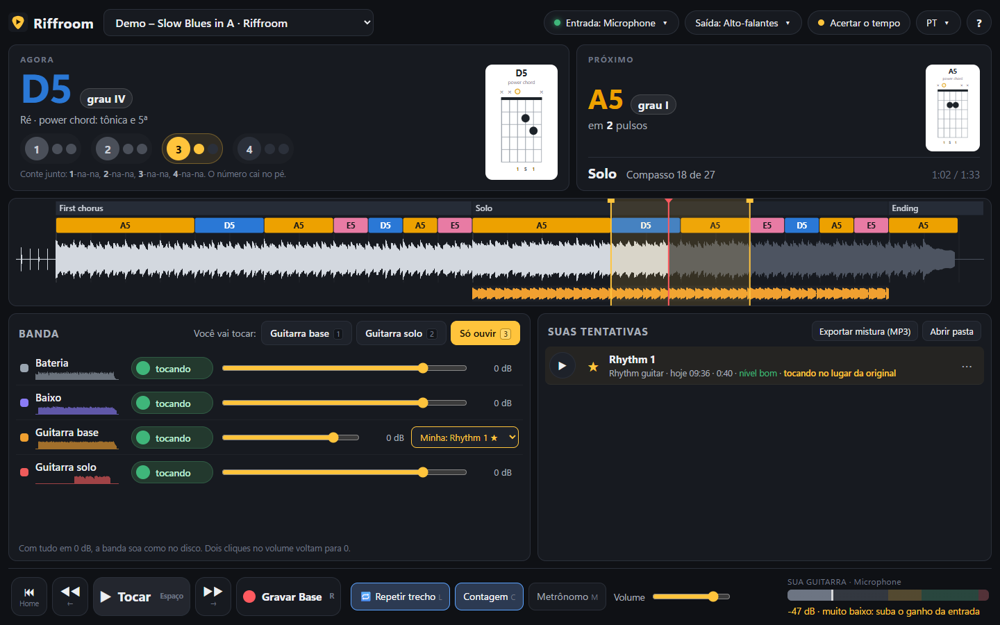

# Riffroom

Toque e grave junto com a banda separada: o acorde e o pulso na tela, e as suas gravações alinhadas com a música e analisadas compasso a compasso. Também funciona com um assistente de IA.

[English](README.md) · **Português** · [Español](README.es.md)



Feito para estudar guitarra em casa, com a pedaleira ligada no computador pela USB (testado com a BOSS GT-100). Funciona com qualquer interface de áudio e qualquer instrumento. É grátis e de código aberto (GPL-3.0). Tudo roda no seu computador: as músicas e as gravações não vão para a nuvem.

## O que ele faz

- **Banda separada**: liga, desliga e muda o volume de cada parte (bateria, baixo, guitarras, voz…). Com tudo em 0 dB, a banda soa como no disco.
- **"Você vai tocar"**: um clique desliga a parte que você vai tocar e define em que parte a gravação entra.
- **Painel AGORA**:
  - o acorde que está soando, o grau (I, IV, V…) e o desenho no braço;
  - o próximo acorde;
  - os pulsos do compasso acendendo no tempo (12/8 ou 4/4).
- **Linha do tempo**: mostra as partes da música, os acordes e a onda.
  - Um clique leva ao compasso.
  - Arrastar marca um trecho para repetir.
  - Dois cliques numa parte da música repetem a parte inteira.
- **Contagem e metrônomo**: 4 pulsos antes de tocar ou gravar, de qualquer ponto.
- **Tentativas**:
  - um botão grava, e cada gravação vira uma tentativa já alinhada com a banda (FLAC de 24 bits);
  - o app mede uma vez o atraso do computador ("Acertar o tempo") e corrige a diferença de relógio entre a interface e a placa de som.
- **Análise do tempo** de cada tentativa, em relação à parte original ou ao pulso:
  - adiantado ou atrasado, e a constância;
  - os compassos para treinar e onde você correu ou arrastou.
- **Comparar**:
  - cada parte toca a original ou uma tentativa sua;
  - favoritas, renomear, apagar (com desfazer), exportar MP3.
- **Letra**, opcional: a linha cantada acende e a letra rola sozinha, ou fica só o texto, para ler.
  - Cole a letra ou deixe um arquivo `.lrc` (letra com o tempo de cada linha) na pasta da música: o Riffroom o alinha pela voz separada.
  - Sem tempos, marque enquanto a música toca, apertando Enter no começo de cada linha.
- **Importar música com IA**: transforma um MP3 em música de ensaio, no seu computador.
  1. O [Demucs](https://github.com/adefossez/demucs) separa os instrumentos.
  2. O [beat-this](https://github.com/CPJKU/beat_this) acha os pulsos e os compassos.
  3. O app sugere os acordes.
- **Feito para assistentes de IA**: um servidor [MCP](https://modelcontextprotocol.io) deixa o Claude (Desktop ou Code), ou qualquer cliente MCP, comandar o Riffroom e ser o seu professor (veja [Com um assistente de IA](#com-um-assistente-de-ia)).
- **Três línguas**: inglês, português e espanhol.

## Do que precisa

- Windows 10 ou 11. A janela do app é a do Edge, que já vem no Windows.
- Python 3.10 ou mais novo (testado no 3.13), grátis em [python.org](https://www.python.org/downloads/).
- Uma interface de áudio para o instrumento: pedaleira com USB (como a BOSS GT-100), placa de som ou a entrada do próprio computador.
- Para a IA local (opcional): uns 1,5 GB de disco.

## Instalar

1. Baixe o ZIP da [última versão](https://github.com/luanmadson/riffroom/releases/latest) e extraia, ou rode:
   ```
   git clone https://github.com/luanmadson/riffroom
   ```
2. Dê dois cliques em **`install.bat`**. Ele:
   - cria o ambiente Python do app em `%LOCALAPPDATA%\Riffroom\venv`;
   - instala as bibliotecas;
   - gera a **música de demonstração** (um blues lento em Lá, sintetizado pelo próprio app);
   - cria o atalho **Riffroom** na Área de Trabalho e no menu Iniciar;
   - registra o Riffroom no Claude Code e no Claude Desktop, quando eles estão instalados;
   - abre o app.

Opções (valem também no `install.bat`):

| Opção | O que faz |
|---|---|
| `-AI` | Instala a IA local: PyTorch para CPU, Demucs, beat-this e librosa (~1,5 GB). |
| `-AI -GPU` | O mesmo, com o PyTorch para placas NVIDIA (CUDA, ~3 GB). A separação leva segundos em vez de minutos. |
| `-Language pt` | Abre em português (`es` para espanhol). Também dá para trocar depois, no app. |
| `-Library PASTA` | Junta uma pasta de músicas. |
| `-NoClaude` | Não registra o Riffroom nos assistentes de IA. |
| `-Uninstall` | Remove os atalhos, o registro e o ambiente. As músicas e as tentativas ficam. |

Se o Windows avisar que o arquivo veio da internet, clique em "Mais informações" e depois em "Executar assim mesmo".

## Primeiros passos

1. Abra o Riffroom pelo atalho. Na primeira vez, um passo a passo mostra cada área.
2. No topo, confira:
   - a **Entrada**, de onde vem a guitarra (a GT-100 é escolhida sozinha);
   - a **Saída**, onde a banda toca: na caixa do computador ou na própria interface.
3. Faça uma vez o **Acertar o tempo**: abafe as cordas e palhete junto com 8 cliques. Leva uns 10 segundos.
4. Em **Você vai tocar**, escolha a parte e aperte **Gravar** (R).
5. O ▶ da tentativa toca a sua no lugar da original. **⋯ > Analisar o tempo** mostra onde você correu ou atrasou.

## Suas músicas

### Importar com IA

No menu das músicas, escolha **＋ Importar música (MP3, WAV, FLAC)… com IA**. Precisa do `install.bat -AI`. O app então:
1. separa os instrumentos (Demucs `htdemucs_6s`: bateria, baixo, guitarra, piano, voz, outros);
2. acha os pulsos e os compassos;
3. põe 4 pulsos de silêncio antes do compasso 1, para a contagem;
4. sugere os acordes;
5. grava tudo em `<pasta de músicas>\<Artista>\<Título>\`.

Numa CPU comum, uma música de 6 minutos leva uns 2 minutos. Os acordes ficam no `chords.txt` como **sugestão**: ouça e corrija (o formato está abaixo) e abra a música de novo.

**Quão boa ela é?** Comparamos a IA com o mapa conferido à mão de um rock real em 12/8.
- **Andamento:** dentro de 1 pulso por minuto.
- **Compassos:** 91% começam a menos de 60 ms dos conferidos.
- **Acordes:** a tônica acerta uns 60% do tempo. Os acordes sus saem como power chord ou maior.

### Pastas com as faixas separadas

O app também acha músicas que você separou. Junte a pasta pelo menu das músicas (**＋ Adicionar pasta de músicas…**). Cada música fica numa pasta própria, com as faixas:

```
Riffroom\
└── Minha banda\
    └── Minha música\
        ├── drums.wav      (bass.wav, guitar.wav, vocals.wav, other.wav, piano.wav: os nomes do Demucs)
        ├── mixture.wav    (opcional: a música inteira, para acertar o volume de cada parte)
        └── chords.txt     (opcional: a cifra)
```

Também valem os nomes em português e espanhol (bateria, baixo, guitarra, voz…), e `rhythm_guitar` e `lead_guitar`. Na primeira vez que você abre a música, o app a prepara sozinho.

Para ver o pulso, o acorde e a contagem, informe o andamento. Rode com o Python do app:

```
%LOCALAPPDATA%\Riffroom\venv\Scripts\python.exe app\prepare.py "<pasta da música>" --bpm 92 --time-signature 4/4 --first-bar 1.25
```

| Opção | O que quer dizer |
|---|---|
| `--bpm` | Pulsos por minuto, o pulso em que você bate o pé. Num 12/8, é a semínima pontuada. |
| `--first-bar` | O segundo em que começa o compasso 1. |
| `--tuning -1` | Para a guitarra afinada meio tom abaixo: os acordes saem com o nome do desenho que você toca. |
| `--targets guitar,vocals` | As partes que aparecem em "Você vai tocar". |

### Cifra (`chords.txt`)

Um compasso por palavra:

```
[Intro]
A5 % D5 A5
[Verso]
A5 % % %
D5 % A5 %
E5 D5,C5 A5 -
```

| Sinal | O que quer dizer |
|---|---|
| `%` | repete o compasso anterior |
| `D5,C5` | divide o compasso entre os dois acordes |
| `-` | compasso sem acorde |
| `[Nome]` | começa uma parte da música |
| `#` no início da linha | comentário |

O app calcula o grau de cada acorde e desenha a digitação. A música de demonstração traz um exemplo completo.

### Letra (`lyrics.lrc`)

O Riffroom não busca letras: elas vêm de você. O botão **Letra** (tecla K) mostra a letra ao lado da banda.

- **Colar**: ⋯ > Editar ou colar a letra. Texto simples (uma linha para cada linha cantada, uma linha em branco entre as estrofes) ou LRC, com o tempo de cada linha: `[01:04.17]Primeira linha`.
- **De um arquivo**: um `.lrc` na pasta da música (ou junto do `riffroom.json` dela) é lido na primeira vez que a música abre. Esses arquivos costumam ter os tempos da gravação original, que começa num ponto diferente das faixas separadas. O Riffroom desloca os tempos para alinhar com a voz separada, quando a música tem, e guarda a cópia dele como `lyrics.lrc`, junto do `riffroom.json`. O arquivo original não muda.
- **Ajuste fino**: os botões −0,1 s e +0,1 s movem todas as linhas; ⋯ > Alinhar pela voz da música tenta de novo.
- **Sem tempos**: ⋯ > Marcar os tempos enquanto toca. Aperte Enter (ou **Agora**) quando cada linha começar; Backspace volta uma linha; Esc termina e salva.
- **Acompanhar** ligado: a linha cantada acende um pouco antes e a lista rola sozinha. Desligado: só o texto, para ler. Clique numa linha para tocar dali.

## Com um assistente de IA

O Riffroom vem com um servidor MCP ([app/mcp_server.py](app/mcp_server.py)). Com ele, um assistente de IA conduz o seu estudo. Por exemplo:

- "Abre a música de demonstração, repete o solo e grava três tentativas da guitarra base."
- "Onde eu corri? O que devo treinar?"
- "Compara as minhas últimas tentativas."
- "Importa C:\Músicas\musica.mp3; a guitarra está meio tom abaixo."
- "Os acordes do verso são A5 D5 A5 E5. Escreve a cifra."

O assistente vê só o que as ferramentas devolvem: a estrutura da música, o estado do app e as análises de tempo, nunca o seu áudio. As ferramentas são:
- músicas: `list_songs`, `open_song`, `get_song_map`;
- tocar: `play`, `pause`, `set_loop`, `clear_loop`;
- banda: `set_part`, `set_target`, `set_options`;
- gravar e tentativas: `record_take`, `stop_recording`, `list_takes`, `play_take`, `update_take`, `delete_take`, `analyze_take`, `compare_takes`, `export_mp3`;
- preparar músicas: `set_chords`, `prepare_song`, `import_song`, `get_job`;
- letra: `get_lyrics` (cada linha com o segundo, o compasso e a parte da música), `set_lyrics`, `shift_lyrics`;
- `calibrate_latency` e `get_status`.

Há também o prompt `coach_session`.

O `install.bat` faz o registro sozinho. Para fazer à mão:

```
claude mcp add riffroom --scope user -- "%LOCALAPPDATA%\Riffroom\venv\Scripts\python.exe" -I -X utf8 "<pasta>\app\mcp_server.py"
```

No Claude Desktop, ponha a entrada `riffroom` em `%APPDATA%\Claude\claude_desktop_config.json` (veja o [README em inglês](README.md#with-an-ai-assistant)) e reinicie o Claude Desktop.

Se o Riffroom estiver fechado quando o assistente precisar dele, o servidor o abre.

## Teclas

| Tecla | O que faz |
|---|---|
| Espaço | tocar e pausar (e parar a gravação) |
| R | gravar e parar |
| Home | voltar ao começo (ou ao começo do trecho) |
| ← → | compasso anterior e próximo |
| L | repetir o trecho, liga e desliga |
| C | contagem, liga e desliga |
| M | metrônomo, liga e desliga |
| K | letra, mostra e esconde |
| 1 2 3… | você vai tocar: os botões do painel Banda, na ordem |
| ? | ajuda |

## Onde ficam os arquivos

| O quê | Onde |
|---|---|
| Tentativas | `Gravações\Tentativas\`, dentro da pasta da música: FLAC e uma ficha `.json`. Em inglês, `Takes\`; em espanhol, `Grabaciones\Tomas\`. Vale a pasta que já existir. |
| Tentativas apagadas | `Gravações\Tentativas\Lixeira\` |
| MP3 exportados | `Gravações\Exportados\` |
| Letra | `lyrics.lrc`, junto do `riffroom.json` da música |
| Configuração e registro | `%LOCALAPPDATA%\Riffroom\` (pastas de músicas, língua, entrada, ajuste do tempo, mix de cada música) |

## Como funciona

Os detalhes técnicos (motor de áudio, alinhamento, análise do tempo, IA) estão no [README em inglês](README.md#how-it-works).

## Testes

```
%LOCALAPPDATA%\Riffroom\venv\Scripts\python.exe -X utf8 tests\run_tests.py
```

Os testes não precisam de aparelho de som. Os de IA rodam quando a IA local está instalada.

## Licença

[GPL-3.0-or-later](LICENSE). A versão 1.0.0, publicada como "Sala de Ensaio", saiu com a licença MIT.
